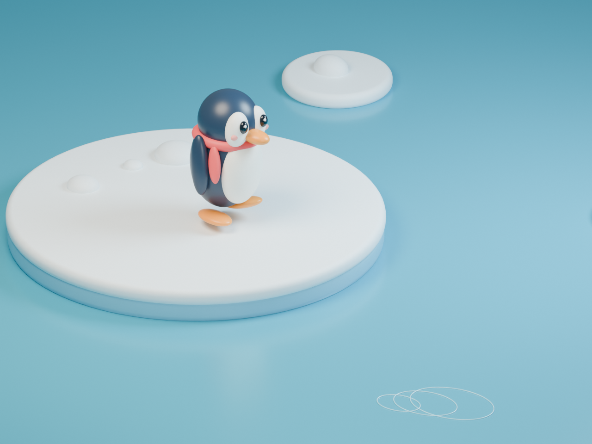

# Blender Runpod Lab

A private experiment for a repeatable Blender GPU render skill.

The first scene uses a porcelain plinth, an orange torus, a teal sphere, and a gold cube.
It needs no external textures or paid assets.

## Sleeping Pikachu in 3D

[Watch the animation](results/pikachu/pikachu-sleep.mp4),
[download the animated GLB](results/pikachu/pikachu-sleep.glb), or
[open the Blender scene](results/pikachu/pikachu-sleep.blend).
See the [scene and run notes](docs/pikachu-sleep.md).

## Runpod ball and wall test

[Watch the ball bounce against a wall](results/ball/ball-wall.mp4).
This five-second test uses Runpod for all renders and video output.
See the [run record and setup findings](docs/ball-wall.md).

## Five-second animation

[Pip takes a dip — watch the video](results/penguin/pip-takes-a-dip.mp4)



The penguin walks, loses balance, splashes into the sea, and returns with a wink.
This animation used the local Apple M4 Pro GPU through Metal after Runpod capacity requests failed.
See the [animation record](docs/penguin-animation.md), [editable scene](results/penguin/penguin.blend),
and [render metadata](results/penguin/render-metadata.json).

## First verified result


Rendered on Runpod in EU-RO-1 with one RTX PRO 4000 Blackwell.
Blender 5.0.1 used Cycles and OptiX at 1600 × 1000.
The render call took 10.569 seconds. The temporary pod was then deleted.
The estimated compute cost was $0.0385, plus storage. This estimate is not an invoice.

The RTX 4090 was unavailable. RTX 5090 allocation attempts failed despite LOW catalog availability.
This result verifies the workflow on the fallback GPU, not 4090 or 5090 performance.

Download the [editable scene](results/first-light.blend) or inspect the [render metadata](results/render-metadata.json).

## Run the scene

Use a Linux Runpod GPU pod with NVIDIA graphics driver access.
Upload `scripts/` with SSH or SCP.

```sh
bash scripts/setup_blender.sh
blender -b --python scripts/render_demo.py -- --output results
```

The script saves a PNG, the Blender scene, and render metadata.
It fails if Blender cannot find an OptiX GPU. It does not silently render on the CPU.

## Project notes

- [Silver tabby cat persona](docs/cat-persona.md)
- [Reference film notes](docs/reference-film.md)
- [Experiment record](docs/experiment.md)
- [Skill draft](SKILL.md)

Never commit API keys, SSH private keys, or raw account responses.
The `.local/` directory holds local connection files and is ignored by Git.

## Blender 5.0.1 Runpod image

A CUDA 12.4 + Blender 5.0.1 image and personal-account Runpod template are documented in [docs/docker-template.md](docs/docker-template.md). The image is `ghcr.io/justinwlin/blender-runpod:5.0.1` (public GHCR package), built by GitHub Actions from [docker/blender/](docker/blender/).

